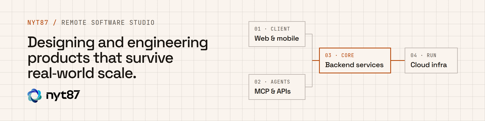

<a href="https://nyt87.github.io">
  <picture>
    <source media="(prefers-color-scheme: dark)" srcset="https://raw.githubusercontent.com/NYT87/.github/main/profile/assets/header-dark.png">
    
  </picture>
</a>

Remote software studio for product, backend and infrastructure work: designing and engineering products that survive real-world scale.

## What we do

- **Web Applications**: Product-grade frontends and full-stack experiences built for performance, usability, and long-term maintainability.
- **Backend Systems**: Scalable APIs and core services with observability, domain modeling, and resilient integrations.
- **Cloud Infrastructure**: Infrastructure and delivery pipelines that keep deployments reliable, secure, and easy to evolve.

## Selected work

- **Criptan**: [project page](https://nyt87.github.io/projects/criptan/) · [criptan.com](https://criptan.com)
  - Client · Fintech · Mobile app
  - Senior backend engineering for Criptan, a regulated Spanish crypto investment app, as the studio's main ongoing client engagement. The codebase is private.
- **Booba Pass**: [project page](https://nyt87.github.io/projects/booba-pass/) · [live app](https://nyt87.github.io/booba-pass/) · [NYT87/booba-pass](https://github.com/NYT87/booba-pass)
  - Open source · Web app · PWA
  - A centralized wallet for airline loyalty information with QR and barcode support, designed for quick access and practical day-to-day use.
- **OpenTrack Viewer**: [project page](https://nyt87.github.io/projects/opentrack-viewer/) · [live app](https://nyt87.github.io/opentrack-viewer/) · [NYT87/opentrack-viewer](https://github.com/NYT87/opentrack-viewer)
  - Open source · Web app · PWA
  - A privacy-first, client-side web app and PWA for viewing activity tracking files, with everything processed locally in the browser.
- **Bongsu**: [project page](https://nyt87.github.io/projects/bongsu/) · [project site](https://nyt87.gitlab.io/bongsu/) · [gitlab.com/nyt87/bongsu](https://gitlab.com/nyt87/bongsu)
  - Open source · Self-hosted · Web app
  - A self-hosted publishing scheduler for creators: Instagram and YouTube Shorts in one queue, where agents can plan but only you approve and publish.
- **Agents PP**: [project page](https://nyt87.github.io/projects/agents-pp/) · [NYT87/agents-pp](https://github.com/NYT87/agents-pp)
  - Open source · Claude Code plugin
  - Pair-programming workflows for coding agents: one agent codes while an independent reviewer comments, looping until every comment is resolved.
- **Drift**: [project page](https://nyt87.github.io/projects/drift/) · [CutWire-Studios/Drift](https://github.com/CutWire-Studios/Drift) · [merged PRs](https://github.com/CutWire-Studios/Drift/pulls?q=is%3Apr+author%3Ajmn8718+is%3Amerged)
  - Open source contribution · Desktop app
  - Ongoing contributions to CutWire Drift, a free, open-source desktop video editor: media bin, start screen, agent access over MCP, lossless rotation and timeline tools.
- **Company website**: [nyt87.github.io](https://nyt87.github.io) · [NYT87/NYT87.github.io](https://github.com/NYT87/NYT87.github.io)
  - Built with [Astro](https://astro.build), deployed with GitHub Actions + GitHub Pages

Client codebases such as Criptan's are private, so only the studio's own projects and upstream contributions are public. We can walk through client work in a conversation.

## How we work

- **Delivery**: A small senior team, direct communication, and milestones tied to shipping decisions.
- **Systems**: Web products, APIs, platform services, and infrastructure built to stay maintainable.
- **Mode**: Remote-first collaboration with documented decisions, clear owners, and steady delivery.

## Approach

1. **Clarify**: Turn an ambiguous product idea into a clear scope with testable outcomes.
2. **Build**: Work inside your workflow and ship against measurable milestones, with execution visible from day one.
3. **Sustain**: Leave maintainable architecture and documented decisions your team can keep evolving.

## Connect

- Website: [nyt87.github.io](https://nyt87.github.io)
- GitHub: [github.com/NYT87](https://github.com/NYT87)
- LinkedIn: [linkedin.com/in/jm8nav](https://www.linkedin.com/in/jm8nav/)
- Email: [nyt87@proton.me](mailto:nyt87@proton.me)
